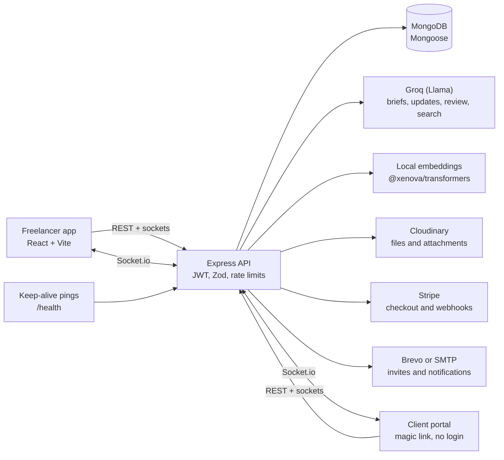

<div align="center">

# ClientSphere

### The calm workspace where freelancers deliver, clients approve, and nobody chases an update again.

[](https://nodejs.org)
[](https://react.dev)
[](https://expressjs.com)
[](https://mongodb.com)
[-F55036)](https://groq.com)
[](https://stripe.com)
[](https://socket.io)

**[Live demo](https://your-frontend-url)** · **[API health](https://your-backend-url/health)** · **[Demo video](https://your-video-link)**

</div>

---

## The problem

Freelancers and small agencies run client work on a mess of tools: email threads for approvals, chat for feedback, spreadsheets for invoices, and screenshots for "what did we agree?"

- **Proposals take hours.** Turning a client's email into milestones, prices and a scope document is slow, repetitive work.
- **Status updates eat the week.** The same "where are we?" note gets rewritten for every client, every Friday.
- **Scope creeps in silently.** A "quick favour" in a chat message becomes ten unpaid hours.
- **Approvals get lost.** Feedback is spread across inboxes, and the wrong version gets signed off.
- **Payments get chased.** Invoices go out late, or are never tied to the work that was approved.
- **Clients hate logging in.** Another account and password is a barrier to honest feedback.

## The solution

ClientSphere puts the whole client relationship in one place, and uses AI for the tedious parts.

| Instead of... | ClientSphere gives you... |
|---|---|
| Writing a plan from scratch after every client call | **Brief to proposal:** paste the client's email, get milestones, prices, due dates, scope and assumptions in seconds |
| Rewriting the same status email every week | **AI progress updates** drafted from real milestones and activity, reviewed by you before sending |
| Hoping nobody notices scope creep | **Scope check** on client messages, with a suggested polite reply ready to copy |
| Approvals lost in threads | **Milestones** with submit, approve and request-changes flow, and a full history |
| Invoices chased by hand | **Invoices drafted on approval**, downloadable as PDF, and payable online through **Stripe Checkout** |
| Making clients create accounts | A **private magic-link portal**: no login, no password |

---

## Feature highlights

### Brief to proposal (new)
- Paste a client's email, call notes or a scope paragraph into the Milestones tab.
- AI returns a scope summary, 3 to 6 milestones with descriptions, amounts and due dates, and a list of assumptions to check.
- Everything is editable: change titles, amounts and dates, remove rows, then add them to the project in one click.
- Nothing is saved until you confirm. Only owners and editors can use it.

### Client portal, no account needed
- Clients open a private link and can review milestones, approve deliverables, request changes, read shared notes and files, download invoices, and pay.
- They see only what you share: milestones, files and notes you mark as shared, and invoices you sent.
- Clients can attach screenshots and documents (up to 10MB) to their messages, and the team sees them in the same discussion.
- Access can be revoked instantly, and invite links expire automatically.

### AI progress updates
- A weekly update is drafted from real milestones, tasks and activity, in plain language a client can read.
- Nothing reaches the client until you press **Send**. It then appears in their portal.
- The draft can be edited, saved, downloaded as a text file, and rewritten with AI.

### Scope check
- Every client message is compared against the agreed milestone scope.
- If a request falls outside it, you see the reason and a polite reply you can copy.

### Milestones, invoices and payments
- Break a project into milestones with due dates and prices.
- Submit for review, and the client approves or asks for changes.
- Approval drafts an invoice. Send it, edit it, download the PDF, or let the client pay through Stripe Checkout.
- Stripe webhooks mark invoices as paid automatically.
- A ledger shows what's outstanding, what's collected, and what's still in draft.

### Notes that think with you
- Markdown notes with a live preview and a quick toolbar.
- **Explain**, **Improve**, and **Extract tasks** actions powered by AI.
- Duplicate detection warns you before you write the same note twice.
- Share a note with the client with one toggle, or keep it internal.

### Files with versions and AI code review
- Upload files up to 10MB. Uploading the same name again saves a new version.
- Uploading a new version of a code file triggers an AI review that compares it with the previous one: a risk level, a summary, and concrete suggestions.
- Text and code files are searchable by their contents.

### Tasks that come from conversations
- Create tasks by hand, or extract them from a note's action items.
- Assign a task to a member. They get a notification straight away.
- Track status and urgency, with a progress ring.

### Discussion with mentions and privacy controls
- Comments are internal by default. Share one with the client, or reply to a client message and share the reply in one step.
- Type `@` and a teammate's email to mention them. They get a notification.
- Attach screenshots and files to messages.

### Search that understands you
- Ask a question in plain English and get an answer that cites its sources: notes, files, messages, milestones and tasks.
- Find files by name as you type, the way a code editor's quick-open does.
- Combines exact word matches with meaning-based matches.

### Notifications that take you there
- Real-time notifications for milestones, comments, mentions, invoices, tasks and team changes.
- Clicking a notification opens the right project and the right tab.

### Project health and analytics
- Each project gets a health status (healthy, slowing, or inactive) based on recent activity.
- Contribution charts show notes and files per member, plus each person's share of the work.

### Team and public sharing
- Invite teammates as **editors** or **viewers**. The invite search suggests existing users as you type.
- Only owners see invoices and client settings.
- Publish a read-only public page with the project's README and notes.

### Voice assistant
- A floating assistant for quick questions about your projects.

---

## Architecture



## Tech stack

| Layer | Technology |
|---|---|
| Frontend | React 18, Vite, React Router, Axios, Recharts, react-markdown, react-hot-toast, lucide-react, socket.io-client |
| Backend | Node.js, Express, Mongoose (MongoDB), Socket.io, Zod validation, express-rate-limit, helmet, multer |
| AI | Groq API (Llama models), local sentence embeddings via `@xenova/transformers` |
| Payments | Stripe Checkout and webhooks |
| Storage | Cloudinary (uploads, attachments and PDFs) |
| Email | Brevo HTTPS API (recommended on hosts that block SMTP), or Nodemailer over SMTP |
| Auth | JWT and bcrypt for team accounts, separate scoped session tokens for client portals |
| Docs | PDFKit for invoice PDFs |

## Project structure

```
collabsphere/
├── backend/
│   ├── controllers/      # Business logic per feature (projects, comments, invoices, AI)
│   ├── routes/           # Staff, client portal and public routers
│   ├── models/           # Mongoose schemas
│   ├── middleware/       # Auth, project access, validation, rate limits, uploads
│   ├── services/         # AI, notifications, email, payments, storage, weekly job
│   ├── utils/            # Zod schemas, password policy, helpers
│   └── tests/            # Security and API tests
└── frontend/
    └── src/
        ├── pages/        # Dashboard, ProjectPage, ClientPortal, LandingPage, auth
        ├── components/   # Milestones, proposal drafter, notes, files, tasks, discussion, search, analytics, ...
        ├── context/      # Auth state
        ├── hooks/        # Realtime (Socket.io)
        └── api/          # Axios client with session handling
```

---

## Getting started

### Prerequisites
- Node.js 20 or newer
- A MongoDB database (local or MongoDB Atlas)
- API keys: Groq and Cloudinary. Stripe, Brevo or SMTP are optional.

### 1. Clone and install

```bash
git clone https://github.com/your-username/collabsphere.git
cd collabsphere

cd backend && npm install
cd ../frontend && npm install
```

### 2. Configure the backend

Copy `backend/.env.example` to `backend/.env` and fill in the values:

| Variable | Purpose |
|---|---|
| `PORT` | API port (default `5000`) |
| `MONGO_URI` | MongoDB connection string |
| `JWT_SECRET`, `JWT_EXPIRES_IN` | Signing key and token lifetime |
| `GROQ_API_KEY`, `GROQ_MODEL`, `GROQ_MODEL_FAST` | AI features (briefs, updates, reviews, search) |
| `CLOUDINARY_CLOUD_NAME`, `CLOUDINARY_API_KEY`, `CLOUDINARY_API_SECRET` | File and attachment storage |
| `CLIENT_URL` | Frontend URL, used in invite and payment links |
| `BREVO_API_KEY` | Invite and notification emails over HTTPS (optional, recommended) |
| `SMTP_HOST`, `SMTP_PORT`, `SMTP_USER`, `SMTP_PASS`, `SMTP_FROM` | Email over SMTP (optional, used when Brevo is not set) |
| `STRIPE_SECRET_KEY`, `STRIPE_WEBHOOK_SECRET` | Online invoice payments (optional) |

Never commit `.env`. It is already listed in `.gitignore`.

If no email provider is configured, invites still work: the app shows the invite link so you can send it yourself.

### 3. Run it

```bash
# Terminal 1: API
cd backend
npm run dev

# Terminal 2: web app
cd frontend
npm run dev
```

Open the frontend URL that Vite prints (usually `http://localhost:5173`), register, and create your first project. To load sample data, run `npm run seed` in `backend/`.

To test payments locally, install the Stripe CLI and run:

```bash
stripe listen --forward-to localhost:5000/api/payments/stripe/webhook
```

Use the `whsec_...` value it prints as `STRIPE_WEBHOOK_SECRET`.

### 4. Run the tests

```bash
cd backend
npm test
```

---

## Deployment

- **Backend:** Any Node host (Render, Railway, Fly.io). Set `MONGO_URI`, `JWT_SECRET`, `GROQ_API_KEY`, Cloudinary keys, `CLIENT_URL`, and optionally `BREVO_API_KEY` or `SMTP_*`.
- **Health check:** `GET /health` returns `200` with `{ status, db, uptimeSeconds }` when the database is connected, and `503` while it is still starting. Use it as the platform's health check path.
- **Keep it awake:** Free hosting plans sleep after inactivity. A scheduled ping to `/health` every 5 to 10 minutes (UptimeRobot, cron-job.org, or a GitHub Actions schedule) keeps the first request fast.
- **Frontend:** Any static host (Vercel, Netlify). Point the API base URL at the deployed backend.
- **Stripe:** Add a production webhook at `https://your-api/api/payments/stripe/webhook` for `checkout.session.completed`, and use its signing secret in production.

## API overview

| Area | Base path | Examples |
|---|---|---|
| Auth | `/api/auth` | register, login |
| Projects | `/api/projects` | projects, members, visibility, health |
| Milestones and invoices | `/api/projects/:id` | milestones, invoices, PDF |
| AI | `/api/projects/:id/ai` | brief proposal, weekly update, README, search, health |
| Client portal | `/api/client` | magic link, portal data, approvals, comments, payments |
| Notes, files, tasks | `/api/notes`, `/api/files`, `/api/tasks` | create, version, review |
| Payments | `/api/payments` | Stripe webhook |
| Public | `/api/public` | read-only project pages |
| Health | `/health` | status and database readiness |

## Security

- Passwords are hashed with bcrypt, and a strength policy is enforced on both client and server.
- Every project route checks membership and role before it runs.
- Client portal sessions are separate from team sessions and scoped to a single project.
- Inputs are validated with Zod, and NoSQL operators are sanitized.
- Rate limits protect login, registration and AI endpoints. Behind a proxy, client IPs are read correctly.
- Helmet sets secure HTTP headers.
- Uploaded files and attachments are served through authenticated endpoints, not public URLs.

## Roadmap

- Client email notifications for new milestones, comments and invoices
- Client file uploads with approval workflow
- Recurring invoices and automatic payment reminders
- Case studies generated from completed projects
- Team activity digests

## Contributing

Pull requests are welcome. For larger changes, open an issue first so we can talk through the approach.

1. Fork the repo and create a branch: `git checkout -b feature/your-idea`
2. Commit with a clear message: `git commit -m "feat(scope): what changed"`
3. Push and open a pull request.

---

## Built with care

ClientSphere started from a simple frustration: good freelancers spend more time chasing updates than doing the work they were hired for. It's an attempt to give that time back, one approval and one clear update at a time.
