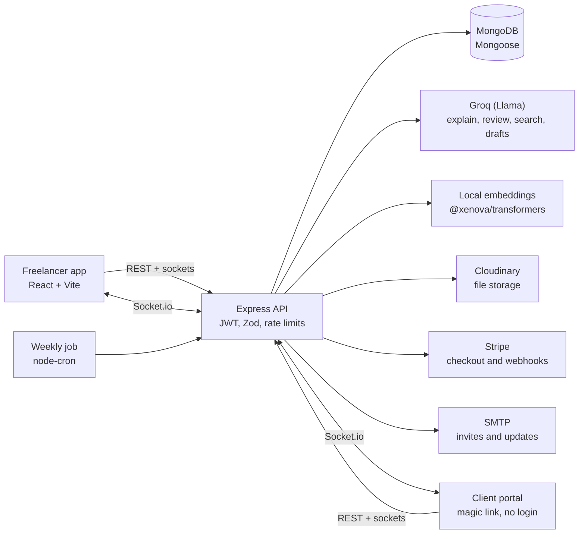

<div align="center">

# ClientSphere

### The calm workspace where freelancers deliver, clients approve, and nobody chases an update again.

[](https://nodejs.org)
[](https://react.dev)
[](https://expressjs.com)
[](https://mongodb.com)
[-F55036)](https://groq.com)
[](https://socket.io)

</div>

---

## The problem

Freelancers and small agencies run client work on a mess of tools: email threads for approvals, chat for feedback, spreadsheets for invoices, and screenshots for "what did we agree?"

- **Status updates eat the week.** The same "where are we?" email gets rewritten for every client, every Friday.
- **Scope creeps in silently.** A "quick favour" in a chat message becomes ten unpaid hours, and nobody agreed to it.
- **Approvals get lost.** Feedback is scattered across inboxes, and the wrong version gets signed off.
- **Payment chases are awkward.** Invoices get sent late, or never tied to the work that was approved.
- **Clients hate logging in.** Asking for yet another account and password is a barrier to honest feedback.

## The solution

ClientSphere puts the whole client relationship in one place, and uses AI to do the tedious parts.

| Instead of... | ClientSphere gives you... |
|---|---|
| Writing the same status email every week | An **AI-drafted progress update** from real milestones and activity, which you review, edit, and send to the client's portal |
| Hoping nobody notices scope creep | **Automatic scope checks** on every client message, with a suggested polite reply you can copy |
| Losing approvals in threads | **Milestones** with a clear review flow: submit, approve, or request changes, with a full history |
| Chasing payments | **Invoices drafted automatically** when a milestone is approved, paid through **Stripe** |
| Making clients create accounts | A **private magic-link portal**: no login, no password, just a secure link |

---

## Feature highlights

### Client portal, no account needed
- Clients get a private link by email and can review milestones, approve deliverables, request changes, download invoices, and pay.
- They see only what you share: milestones, files and notes you mark as shared, and invoices you sent.
- Access can be revoked instantly, and links expire automatically.
- Clients can attach files and screenshots to messages, so the team sees them in the same discussion.

### AI progress updates
- A weekly update is drafted from real milestones, tasks and activity, in plain language a client can read.
- Nothing reaches the client until you press **Send**. It then appears in their portal and is emailed to them.
- A scheduled job prepares drafts automatically each week.

### Scope creep detection
- Every client comment is compared against your milestone descriptions.
- If a request falls outside the agreed scope, you see the reason and a suggested reply, ready to copy.

### Milestones, invoices and payments
- Break a project into milestones with due dates and prices.
- Submit a milestone for review, and the client approves or asks for changes.
- Approval drafts an invoice. Send it, edit it, download the PDF, or let the client pay through Stripe Checkout.
- A ledger shows what's outstanding, what's collected, and what's still in draft.

### Notes that think with you
- Rich markdown notes with a live preview and a quick toolbar.
- **Explain**, **Improve**, and **Extract tasks** actions powered by AI.
- Duplicate detection warns you before you write the same note twice.
- Share a note with the client with one toggle, or keep it internal.

### Files with versions and AI code review
- Upload files up to 10MB. Uploading the same name again saves a new version.
- Uploading a new version of a code file triggers an **AI review** that compares it with the previous version: a risk level, a summary, and concrete suggestions.
- Text and code files are searchable by their content.

### Tasks that come from conversations
- Tasks can be created by hand or extracted from a note's action items.
- Assign a task to a project member. They get a notification straight away.
- Track status (to do, in progress, done) and urgency, with a progress ring.

### Discussion with mentions and privacy controls
- Comments are internal by default. Share one with the client, or reply to a client message and share the reply in one step.
- Type `@` and the email of a teammate to mention them. They get a notification.
- Attach screenshots and files to messages.

### Semantic search that finds what you mean
- Ask a question in plain English and get an answer that cites its sources: notes, files, messages, milestones and tasks.
- Find files by name as you type, the way a code editor's quick-open does.
- Combines exact word matches with meaning-based matches.

### Project health and analytics
- Every project gets a health score: **healthy**, **slowing**, or **inactive**, based on recent activity.
- Contribution charts show notes and files per member, plus each person's share of the work.

### Team and public sharing
- Invite teammates as **editors** or **viewers**. Only owners see invoices and client settings.
- Publish a read-only public page with the project's README and notes.
- Everyone on the project sees live presence, and notifications arrive in real time.

### Voice assistant
- A floating assistant that answers questions about your projects.

---

## Architecture



## Tech stack

| Layer | Technology |
|---|---|
| Frontend | React 18, Vite, React Router, Axios, Recharts, react-markdown, react-hot-toast, lucide-react, socket.io-client |
| Backend | Node.js, Express, Mongoose (MongoDB), Socket.io, Zod validation, express-rate-limit, helmet |
| AI | Groq API , local sentence embeddings via `@xenova/transformers` |
| Payments | Stripe Checkout and webhooks |
| Storage | Cloudinary (uploads and PDFs), multer for multipart |
| Email | Nodemailer over SMTP (works with Resend, Brevo, or any SMTP provider) |
| Auth | JWT, bcrypt, separate scoped client session tokens |
| Docs | PDFKit for invoice PDFs |
| Testing | Jest, Supertest, mongodb-memory-server |

## Project structure

```
collabsphere/
├── backend/
│   ├── controllers/      # Business logic per feature
│   ├── routes/           # Express routers (staff, client portal, public)
│   ├── models/           # Mongoose schemas
│   ├── middleware/       # Auth, project access, validation, rate limits
│   ├── services/         # AI, notifications, email, payments, uploads, weekly job
│   ├── utils/            # Zod schemas, password policy, helpers
│   └── tests/            # Security and API tests
└── frontend/
    └── src/
        ├── pages/        # Dashboard, ProjectPage, ClientPortal, auth, public
        ├── components/   # Milestones, notes, files, tasks, discussion, analytics, ...
        ├── context/      # Auth state
        ├── hooks/        # Realtime (Socket.io)
        └── api/          # Axios client with session handling
```

---

## Getting started

### Prerequisites
- Node.js 20 or newer
- A MongoDB database (local or MongoDB Atlas)
- API keys: Groq, Cloudinary, and optionally Stripe and an SMTP provider

### 1. Clone and install

```bash
git clone https://github.com/your-username/collabsphere.git
cd collabsphere

cd backend && npm install
cd ../frontend && npm install
```

### 2. Configure the backend

Copy `backend/.env.example` to `backend/.env` and fill in the values:

| Variable | Purpose |
|---|---|
| `PORT` | API port (default `5000`) |
| `MONGO_URI` | MongoDB connection string |
| `JWT_SECRET`, `JWT_EXPIRES_IN` | Signing key and token lifetime |
| `GROQ_API_KEY`, `GROQ_MODEL`, `GROQ_MODEL_FAST` | AI features |
| `CLOUDINARY_CLOUD_NAME`, `CLOUDINARY_API_KEY`, `CLOUDINARY_API_SECRET` | File storage |
| `CLIENT_URL` | Frontend URL, used in client invite links |
| `SMTP_HOST`, `SMTP_PORT`, `SMTP_USER`, `SMTP_PASS`, `SMTP_FROM` | Invite and update emails (optional) |
| `STRIPE_SECRET_KEY`, `STRIPE_WEBHOOK_SECRET` | Client payments (optional) |

Never commit `.env`. It is already listed in `.gitignore`.

### 3. Run it

```bash
# Terminal 1: API
cd backend
npm run dev

# Terminal 2: web app
cd frontend
npm run dev
```

Open the frontend URL that Vite prints (usually `http://localhost:5173`), register, and create your first project. To load sample data, run `npm run seed` in `backend/`.

### 4. Run the tests

```bash
cd backend
npm test
```

---

## Security

- Passwords are hashed with bcrypt, and a strength policy is enforced on both client and server.
- Every project route checks membership and role before it runs.
- Client portal sessions are separate from staff sessions and scoped to a single project.
- Inputs are validated with Zod, and NoSQL operators are sanitized.
- Rate limits protect login, registration, and AI endpoints.
- Helmet sets secure HTTP headers.
- Uploaded files are served through authenticated endpoints, not public URLs.

## Roadmap

- Email notifications for clients (new milestones, comments, and invoices)
- Client file uploads with approval
- Recurring invoices and payment reminders
- Mobile-first client portal improvements
- Team activity digests

## Contributing

Pull requests are welcome. For larger changes, open an issue first so we can talk through the approach.

1. Fork the repo and create a branch: `git checkout -b feature/your-idea`
2. Commit with a clear message: `git commit -m "feat(scope): what changed"`
3. Push and open a pull request.

## Built with care

ClientSphere started from a simple frustration: good freelancers spend more time chasing updates than doing the work they were hired for. It's an attempt to give that time back, one approval and one clear update at a time.
---

<div align="center">

Built for freelancers who would rather be building than chasing updates.

</div>
